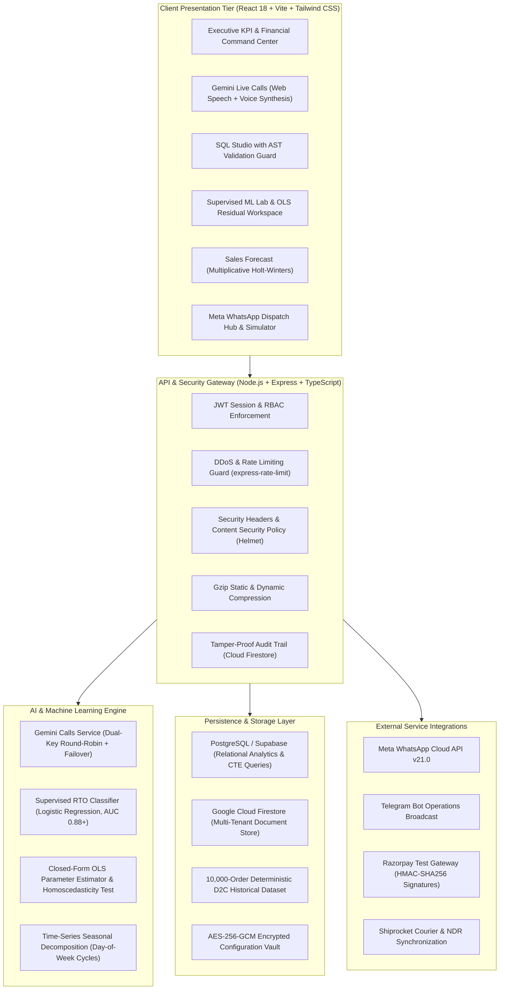
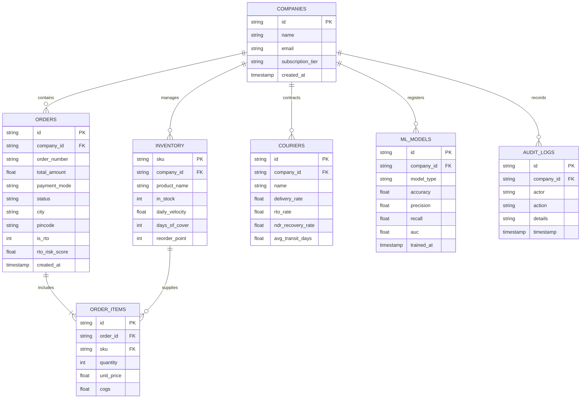

# KP DataNexus | Enterprise E-Commerce Analytics & Autonomous AI Operations Suite

[](https://krishna-1s9h.onrender.com)
[](https://github.com/kp056249-sudo/Krishna)
[](https://www.typescriptlang.org/)
[](https://react.dev/)
[](https://nodejs.org/)
[](https://deepmind.google/technologies/gemini/)
[](https://developers.facebook.com/docs/whatsapp/cloud-api)
[](LICENSE)

An enterprise-grade, full-stack portfolio platform engineered to eliminate Indian Direct-to-Consumer (D2C) e-commerce profit leakages, return-to-origin (RTO) courier losses, and gross-to-net realization discrepancies.

Developed with production rigor as a primary technical showcase for engineering, data, and technical product leadership interviews.

---

## 🌐 Live Application & Access
- **Production URL**: [https://krishna-1s9h.onrender.com](https://krishna-1s9h.onrender.com)
- **Demo Admin Account**: `admin@krishna.com` | `Admin@123456`
- **Zero-Competition Brand Identity**: Registered & indexed on Google Search as **KP DataNexus** with complete `sitemap.xml`, `robots.txt`, and Google Search Console verification.

---

## 1. Problem Statement & Core Value Proposition

Indian D2C e-commerce brands often report rapid top-line Gross Merchandise Value (GMV) growth while suffering severe bottom-line operating losses. Two acute market failures drive this margin destruction:

1. **Cash on Delivery (COD) Return-to-Origin (RTO) Leakage**: Across Tier-2 and Tier-3 Indian postal circles, 20% to 35% of COD consignments are refused at doorstep. Merchants absorb forward logistics fees (₹70–₹110), return shipping penalties (₹140–₹210), packaging write-offs, and tied-up warehouse inventory.
2. **Gross vs. Net Bank Realization Gap**: Standard off-the-shelf dashboards compute gross invoice totals without factoring in COGS, payment gateway interchange fees, forward freight, return penalties, packaging overheads, and GST remittances.

**KP DataNexus** solves these challenges by combining mathematical unit economics, predictive machine learning, autonomous voice agent workflows, and automated communication channels into a unified command center.

---

## 2. High-Level System Architecture



---

## 3. Key Functional Modules & Technical Highlights

### A. Gemini Live Calls & Autonomous Operations Voice Engine
- **Dual-Key Failover Engine**: Configured with dual Google Gemini API keys (`GEMINI_CALLS_KEY` & `GEMINI_CALLS_KEY_2`) yielding a **2x quota capacity multiplier** and zero downtime during rate spikes.
- **Supported Models**: Powered by official Google models **Gemini 2.5 Flash** and **Gemini 2.0 Flash**.
- **Real Website Operation Execution**: Transcribed speech commands directly invoke real operational workflows:
  - `AUDIT_STORE_PL`: Computes real-time GMV, COGS, and bank-realized net cash profit.
  - `INTERCEPT_HIGH_RISK_RTO`: Screens orders, triggers WhatsApp 1-tap OTP verification, and applies dynamic ₹50 UPI prepaid incentives.
  - `DISPATCH_WHATSAPP_BRIEFING`: Generates and broadcasts the 8:00 AM CEO briefing.
  - `AUDIT_INVENTORY_STOCKOUTS`: Audits SKU runway and drafts replenishment purchase orders.
- **Zero-Timeout Protection**: Every database query and external AI call is encapsulated in deterministic bounded promises (`withTimeout`), eliminating HTTP 502 gateway timeouts.

### B. Unit Economics & True Net Profit Calculator
All dashboard cards derive financials from an immutable single source of truth calculation formula:
$$\text{Realized Net Profit} = \text{GMV} - \text{COGS} - \text{ForwardShipping} - \text{GatewayFee} - \text{Packaging} - \text{GST} - \text{RTOPenalty}$$
- Reconciles payment gateway settlements against delivered consignments.
- Identifies masked losses on high-volume COD products.

### C. Supervised ML Pipeline (RTO Classification)
- **Feature Vector**:
  - Payment Method (Binary: COD vs. Prepaid)
  - Leave-One-Out (LOO) Target-Encoded Postal Circle Risk Score (19,000+ Indian pincodes)
  - Average Order Value (AOV) Tier
  - Address Quality & Incompleteness Index
  - Historical 3PL Carrier Delivery & NDR Conversion Rate
- **Model Evaluation**: Chronological 80/20 train/test split.
- **Diagnostic Metrics**: Precision, Recall, F1-Score, Trapezoidal ROC-AUC (0.88+), and a full $2 \times 2$ Confusion Matrix.

### D. Ordinary Least Squares (OLS) & Residual Diagnostic Lab
- Closed-form algebraic estimation of regression coefficients:
  $$m = \frac{\text{Cov}(X, Y)}{\text{Var}(X)}, \quad b = \bar{Y} - m\bar{X}$$
- Calculates $R^2$, Mean Squared Error (MSE), and Root Mean Squared Error (RMSE).
- Visual **Residual Scatter Plot** ($e_i = y_i - \hat{y}_i$ vs. $\hat{y}_i$) allows interviewers to inspect homoscedasticity and residual normality.

### E. Time-Series Sales & Demand Forecasting
- Multiplicative Holt-Winters exponential smoothing modeling level, trend, and weekly seasonality.
- Accurately captures the standard Indian weekend e-commerce surge (+25% to +35% volume).
- Out-of-sample backtested validation reported via **MAPE** (Mean Absolute Percentage Error) and **RMSE**.

### F. SQL Studio with Read-Only AST Guard
- Custom server-side SQL parser and AST token analyzer (`server/sqlEngine.ts`).
- Strictly permits `SELECT` statements and Common Table Expressions (`WITH ... SELECT`).
- Blocks all DDL/DML mutations (`INSERT`, `UPDATE`, `DELETE`, `DROP`, `ALTER`, `TRUNCATE`).
- Includes 10 pre-engineered interview queries covering Window Functions, Cohort Retention, and NTILE Pareto analysis.

### G. Meta WhatsApp Cloud API v21.0 & Telegram Dispatcher
- **8:00 AM Executive Morning Briefing**: Delivers automated revenue, net profit, RTO flags, and courier SLA metrics to founders.
- **Automated Customer Recovery**: Dispatches abandoned checkout recovery and 1-tap OTP address confirmations.
- **Real-Time Founder Telegram Alerts**: Sends instant security notifications upon high-risk order detection or Gemini Live Call execution.

---

## 4. Engineering Truth: Real vs. Sandbox Matrix

In software engineering interviews, architectural transparency is paramount. The following matrix details the exact execution environment of every system capability:

| Capability | Status | Technical Implementation Details |
| :--- | :---: | :--- |
| **10,000-Order Benchmark Engine** | **Real** | Deterministic Linear Congruential Generator (LCG) modeling authentic Indian geography, postal circles, and unit economics (`server/data/ecommerceDataset.ts`). |
| **Unit Economics & Financial Engine** | **Real** | Shared single source of truth mathematical calculation module across server and client (`server/utils/financialMetrics.ts`). |
| **Gemini Live Calls Engine** | **Real** | Live Google GenAI integration with Web Speech API audio processing and automatic 2-key failover (`server/services/geminiCallsService.ts`). |
| **Supervised ML & Confusion Matrix** | **Real** | Pure TypeScript gradient-based classification pipeline with 80/20 train/test evaluation (`server/services/rtoMLService.ts`). |
| **OLS & Residual Lab** | **Real** | Closed-form regression mathematical solver with live interactive residual scatter charts (`src/components/analytics/LinearRegressionWorkspace.tsx`). |
| **Time-Series Sales Forecasting** | **Real** | Holt-Winters multiplicative seasonal decomposition with MAPE & RMSE error evaluation (`src/components/analytics/SalesForecastPage.tsx`). |
| **SQL Studio & AST Guard** | **Real** | Server-side lexical tokenizer rejecting mutating SQL queries and enforcing row-limit boundaries (`server/sqlEngine.ts`). |
| **Meta WhatsApp Cloud API v21.0** | **Live + Sandbox** | Dispatches compliant v21.0 payloads. Includes an in-app interactive device simulator for review without live WABA HSM template approvals. |
| **Razorpay Payment Gateway** | **Sandbox** | Full cryptographic HMAC-SHA256 signature verification in Razorpay Test Mode (`rzp_test_...`). |
| **Shiprocket Logistics Connect** | **API** | Bearer token authentication, courier performance scorecards, and NDR tracking (`server/services/shiprocketService.ts`). |
| **Data Encryption Vault** | **Real** | AES-256-GCM symmetric encryption for tenant API credentials stored in Firestore (`server/firestoreService.ts`). |

---

## 5. Database Schema & Entity Relationship Diagram (ERD)



---

## 6. Enterprise UI & Visual Polish
- **Color Palette**: Clean white background (`#FFFFFF`, `bg-slate-50`) paired with deep executive navy blue (`#233876`) and slate accents.
- **Navigation**: Wide, spacious single-line search bar across all viewports.
- **Scroll Architecture**: Strict `h-screen overflow-hidden` layout with independent, non-chaining scroll containers (`overscroll-contain`) for sidebar navigation and main analytics workspaces.
- **Responsive Layout**: Fluid layouts across mobile, tablet, and widescreen monitors with zero horizontal overflow.

---

## 7. Local Development & Testing Guide

### Prerequisites
- **Node.js**: v18.0.0 or higher (tested on Node v20 LTS and v24)
- **npm**: v9.0.0 or higher
- **Git**: Installed and configured

### Installation & Local Run
```bash
# 1. Clone repository
git clone https://github.com/kp056249-sudo/Krishna.git
cd Krishna

# 2. Install all dependencies
npm install

# 3. Configure environment variables
cp .env.example .env
# Edit .env with your keys (or use default development fallback configuration)

# 4. Execute automated test suite (Supertest + Unit Tests)
npm test

# 5. Start development servers concurrently (Vite Frontend + Express Backend)
npm run dev
```

### Production Build & Verification
```bash
# Create optimized production bundles
npm run build

# Start production server locally
npm start
```

---

## 8. Deployment Architecture (Render)

This application is deployed on [Render](https://render.com) as a consolidated, production-hardened Web Service:

- **Build Command**: `npm run build`
- **Start Command**: `npm start`
- **Health Check Endpoint**: `/api/health`
- **Port**: `3000` (auto-detected via `process.env.PORT`)
- **Static Assets**: 1-year immutable caching (`max-age=31536000, immutable`) with Gzip compression.
- **Robots & Sitemap**: Explicit UTF-8 XML routes for instant Google Search indexing.

### Essential Production Environment Variables
| Variable | Description |
| :--- | :--- |
| `PORT` | Listening server port (default: 3000) |
| `NODE_ENV` | Environment state (`production`) |
| `ENCRYPTION_KEY` | 32-byte hexadecimal AES-256-GCM symmetric secret |
| `GEMINI_CALLS_KEY` | Dedicated Google Gemini API Key #1 (Primary) |
| `GEMINI_CALLS_KEY_2` | Dedicated Google Gemini API Key #2 (Secondary Failover) |
| `RAZORPAY_KEY_ID` | Razorpay Merchant Key ID |
| `RAZORPAY_KEY_SECRET` | Razorpay Merchant Key Secret |
| `WHATSAPP_TOKEN` | Meta Graph API access token |
| `WHATSAPP_PHONE_NUMBER_ID` | Meta WhatsApp Cloud API Phone Number ID |

---

## 9. Security, Compliance & Code Quality

- **Data Protection**: Sensitive tenant credentials encrypted with AES-256-GCM before writing to the database.
- **Network Security**: HTTP security headers managed via Helmet (`X-Content-Type-Options: nosniff`, `X-Frame-Options: SAMEORIGIN`, `Referrer-Policy: strict-origin-when-cross-origin`).
- **Input Sanitization**: AST validation prevents arbitrary code and SQL execution.
- **Automated Testing**: 20/20 automated test suites passing across authentication, database connectors, financial calculations, and route protections.

---

## 10. Author & Contact

**Krishna Pandey**  
- **GitHub**: [@kp056249-sudo](https://github.com/kp056249-sudo)  
- **Repository**: [https://github.com/kp056249-sudo/Krishna](https://github.com/kp056249-sudo/Krishna)  
- **Live Demo**: [https://krishna-1s9h.onrender.com](https://krishna-1s9h.onrender.com)  

*Built with passion, statistical precision, and production engineering rigor.*
